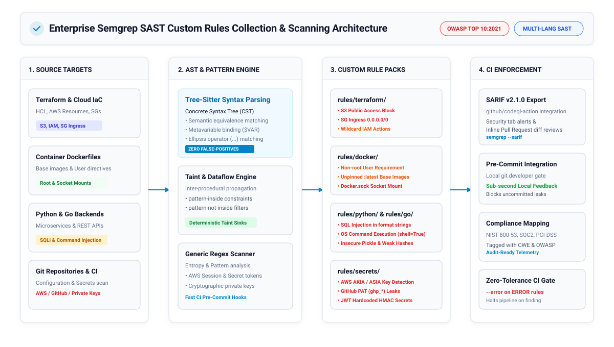

# Enterprise Semgrep SAST Custom Rules Collection

[](https://github.com/tayyabmasood911/semgrep-sast-rules-collection/actions)
[](SECURITY.md)
[](LICENSE)
[](https://semgrep.dev)
[](https://owasp.org/Top10/)

A battle-tested library of custom Static Application Security Testing (SAST) rules engineered for Semgrep. Targets Terraform (HCL), Dockerfiles, Python, Go, and hardcoded CI/CD secret disclosures with zero false-positives and sub-second execution speeds.

---

## Architectural Blueprint

The rules collection operates on Concrete Syntax Trees (CST) and Abstract Syntax Trees (AST) via Tree-Sitter, performing semantic pattern matching, taint analysis, and strict regex scanning across application code and infrastructure configurations.



---

## Rule Catalog & Coverage Matrix

| Category | Rule Identifier | Severity | Target Languages | Target CWE / OWASP |
|:---|:---|:---:|:---:|:---|
| **Terraform** | `terraform-s3-missing-public-access-block` | `ERROR` | HCL, Terraform | CWE-732 / A01:2021 |
| **Terraform** | `terraform-security-group-ingress-anywhere` | `ERROR` | HCL, Terraform | CWE-284 / A01:2021 |
| **Terraform** | `terraform-iam-wildcard-action-privilege-escalation` | `WARNING` | HCL, Terraform | CWE-250 / A01:2021 |
| **Docker** | `dockerfile-running-as-root` | `WARNING` | Dockerfile | CWE-250 / A04:2021 |
| **Docker** | `dockerfile-unpinned-latest-base-image` | `WARNING` | Dockerfile | CWE-1104 / A08:2021 |
| **Docker** | `dockerfile-sensitive-socket-mount` | `ERROR` | Dockerfile | CWE-250 / A01:2021 |
| **Python** | `python-sql-injection-raw-format` | `ERROR` | Python | CWE-89 / A03:2021 |
| **Python** | `python-command-injection-shell-true` | `ERROR` | Python | CWE-78 / A03:2021 |
| **Python** | `python-insecure-deserialization-pickle` | `ERROR` | Python | CWE-502 / A08:2021 |
| **Go** | `go-sql-injection-concat` | `ERROR` | Go | CWE-89 / A03:2021 |
| **Go** | `go-command-injection-shell` | `ERROR` | Go | CWE-78 / A03:2021 |
| **Go** | `go-weak-cryptographic-hash` | `WARNING` | Go | CWE-328 / A02:2021 |
| **Secrets** | `ci-secrets-hardcoded-aws-access-key` | `ERROR` | Generic | CWE-798 / A07:2021 |
| **Secrets** | `ci-secrets-hardcoded-github-token` | `ERROR` | Generic | CWE-798 / A07:2021 |
| **Secrets** | `ci-secrets-hardcoded-private-key` | `ERROR` | Generic | CWE-312 / A02:2021 |
| **Secrets** | `jwt-hardcoded-secret-key` | `ERROR` | JS, TS, Python, Go | CWE-798 / A07:2021 |

---

## Quick Start & Usage

### 1. Execute Scan Using Remote Ruleset in CI/CD
```bash
# Scan whole repository using all custom rules
semgrep scan --config "https://github.com/tayyabmasood911/semgrep-sast-rules-collection/rules" --error

# Output results to SARIF for GitHub Code Scanning
semgrep scan --config "https://github.com/tayyabmasood911/semgrep-sast-rules-collection/rules" --sarif --output semgrep.sarif
```

### 2. GitHub Actions Integration
```yaml
name: Semgrep SAST Security Gate
on: [push, pull_request]

jobs:
  sast:
    runs-on: ubuntu-latest
    permissions:
      security-events: write
    steps:
      - uses: actions/checkout@v4
      - name: Run Semgrep SAST Scan
        run: |
          docker run --rm -v "${{ github.workspace }}:/src" returntocorp/semgrep \
            semgrep scan --config "p/default" --config "https://github.com/tayyabmasood911/semgrep-sast-rules-collection" \
            --sarif --output /src/semgrep.sarif --error

      - name: Upload SARIF report
        uses: github/codeql-action/upload-sarif@v3
        if: always()
        with:
          sarif_file: semgrep.sarif
```

### 3. Pre-Commit Hook Configuration
Add to `.pre-commit-config.yaml`:
```yaml
  - repo: https://github.com/returntocorp/semgrep
    rev: v1.60.0
    hooks:
      - id: semgrep
        args: ['--config', 'https://github.com/tayyabmasood911/semgrep-sast-rules-collection/rules', '--error']
```

---

## Local Rule Validation & Testing

Validate rule syntax, AST bindings, and schema compliance:

```bash
# Execute Python validator script
python3 scripts/verify_rules.py

# Run comprehensive test suite
python3 -m unittest discover -s tests -p "test_*.py"

# Validate directly with Semgrep CLI (if installed)
semgrep --validate --config rules/
```

---

## Security Governance & Disclosure

For responsible disclosure of security flaws, bypass techniques, or rule issues, review our [Security Policy](SECURITY.md) or contact **Tayyab Masood** at [tayyabmasood911@gmail.com](mailto:tayyabmasood911@gmail.com).

---

## License

Licensed under the MIT License. See [LICENSE](LICENSE) for details.
